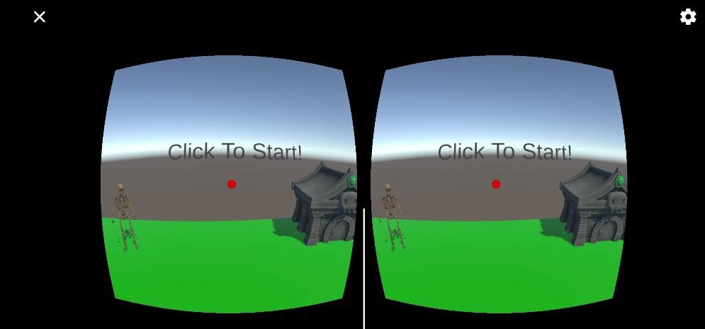
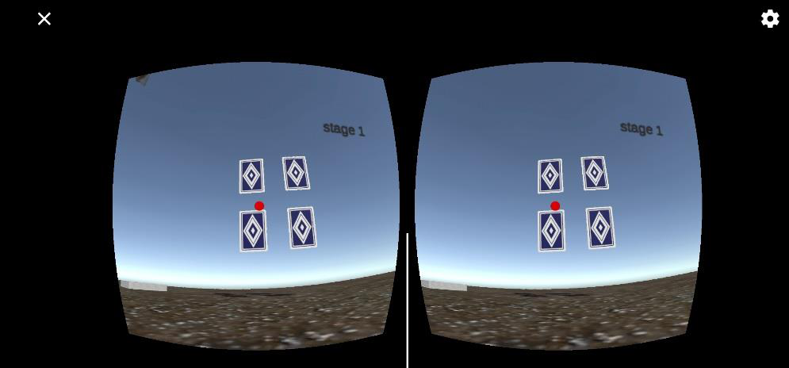
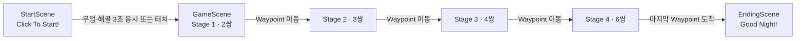
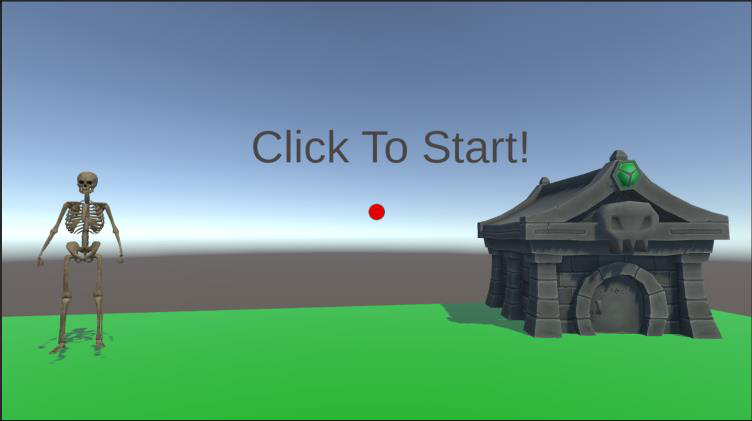
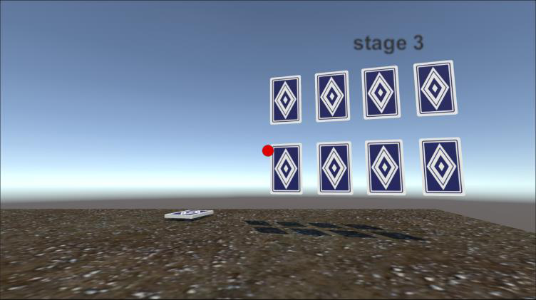
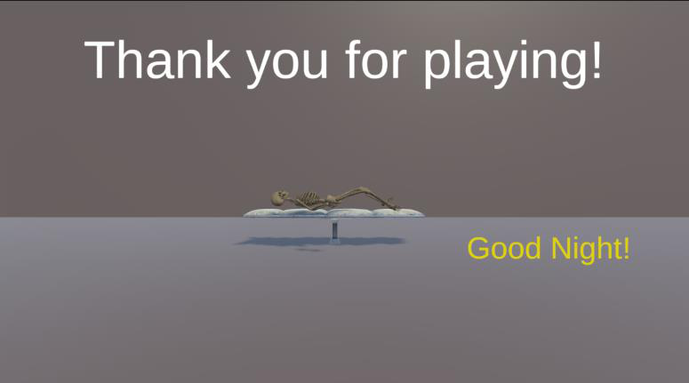

# 잠들게 해주세요 (Please Sleep Me)

<p>
  
  
  
  
</p>

> 무덤 밖으로 나온 해골이 다시 잠들 수 있도록, **고개를 돌려 카드 짝을 맞추는** 모바일 VR 퍼즐 게임

<p align="center">
  
  
</p>

| 항목 | 내용 |
| --- | --- |
| 분류 | 가상현실 수업 기말 프로젝트 (2023년 1학기, 6월 1일 발표) |
| 플랫폼 | Android + Google Cardboard |
| 조작 | 머리 움직임으로 조준(시선 레이캐스트) + 화면 터치 |

📄 [발표 자료 (PDF)](잠들게%20해주세요.pdf) · 🎬 [플레이 영상 (MP4)](플레이%20영상.mp4)

## 사용 기술

| 분류 | 기술 | 사용한 곳 |
| --- | --- | --- |
| 엔진 / 언어 | Unity 2021.3.17f1, C# | 전체 개발 |
| VR | Google Cardboard XR Plugin 1.19.0 | 양안 스테레오 렌더링, 헤드 트래킹 |
| 입력 | `Physics.Raycast`, 터치 입력 | 화면 중앙 시선으로 무덤·카드 선택 |
| 게임 로직 | `Coroutine`, `SceneManager` | 카드 매칭 지연 연출, 시작 → 게임 → 엔딩 씬 전환 |
| 이동 | Waypoint, `Quaternion.Slerp` | 스테이지 클리어 후 무덤 쪽으로 자동 이동 |
| UI / 사운드 | UGUI(`Image.fillAmount`, `Text`), `AudioSource` | 응시 게이지, 스테이지 표시, 효과음 |
| 에디터 도구 | `Gizmos` | Scene 뷰에 Waypoint 경로 표시 |

---

## 게임 소개

- 카드 짝 맞추기를 진행해 해골을 다시 무덤으로 돌려보내는 게임입니다.
- 같은 숫자가 적힌 카드 2장을 뒤집으면 두 카드가 사라집니다.
- 스테이지를 깰 때마다 플레이어가 무덤 쪽으로 자동으로 이동하고, 모든 스테이지를 깨면 해골이 무덤으로 돌아가 잠듭니다.
- 시간 제한이나 점수 같은 경쟁 요소를 넣지 않아 느긋하게 즐길 수 있도록 했습니다.

## 게임 흐름



| 시작 화면 | 스테이지 3 | 엔딩 |
| :---: | :---: | :---: |
|  |  |  |
| 가운데 빨간 점(레티클)으로 무덤이나 해골을 바라보면 게이지가 차오름 | 스테이지가 올라갈수록 카드 수가 늘어남 | 해골이 침대에 누워 잠들며 끝남 |

## 구현 내용

### 1. 시선 기반 입력 (Raycast)
카메라 화면 중앙에서 레이를 쏴서 플레이어가 바라보는 오브젝트를 판단합니다.
- **시작**(`Start` 태그가 붙은 무덤·해골): 무덤이나 해골을 바라보고 있으면 레티클 게이지(`Image.fillAmount`)가 3초에 걸쳐 차오르고, 다 차거나 바라본 상태에서 화면을 터치하면 게임 씬으로 넘어갑니다.
- **카드**(`Card` 태그): 바라본 상태에서 화면을 터치하면 카드가 180° 회전해 뒤집힙니다.

### 2. 카드 매칭 (Coroutine)
첫 번째 카드를 기억해 두었다가 두 번째 카드와 비교합니다.
- **짝이 맞으면** `MatchCards` 코루틴이 0.5초 동안 카드를 보여준 뒤 두 카드를 제거합니다.
- **짝이 틀리면** `FlipCardsBack` 코루틴이 0.7초 뒤 두 카드를 다시 뒤집습니다.
- 카드 선택, 매칭 실패, 매칭 성공, 전체 클리어마다 각각 다른 효과음을 재생합니다.
- 누적으로 맞춘 쌍이 2 / 5 / 9 / 15가 되면 각각 스테이지 1·2·3·4를 클리어한 것으로 처리합니다.

```csharp
// 카드 비교: 같은 카드면 보여준 뒤 제거, 다르면 잠시 후 다시 뒤집기
if (hit.transform.gameObject.name == flippedCard.name)
    StartCoroutine(MatchCards(flippedCard, hit.transform.gameObject));
else
    StartCoroutine(FlipCardsBack(flippedCard, hit.transform.gameObject));
```

### 3. 자동 이동 (Waypoint)
스테이지 사이 이동은 플레이어가 조작하지 않아도 Waypoint를 따라 자동으로 진행됩니다.
- 스테이지를 클리어하면 다음 Waypoint 방향으로 `Quaternion.Slerp`를 써서 부드럽게 회전하며 전진합니다.
- Waypoint의 트리거 콜라이더에 닿으면 멈추고, 마지막 Waypoint에 닿으면 엔딩 씬을 불러옵니다.
- `WaypointTrack`은 에디터 Scene 뷰에 Waypoint 경로를 노란 선(Gizmo)으로 그려 경로를 쉽게 배치할 수 있도록 했습니다.

### 4. 에디터 테스트용 시점 조작
Google Cardboard 샘플의 `CameraPointer`를 수정해, 에디터에서는 **왼쪽 Alt + 마우스**로 고개 회전을 흉내 낼 수 있게 했습니다(상하 각도는 ±90°로 제한). 기기에 빌드하지 않고도 시선 조작을 바로 테스트할 수 있습니다.

## 스크립트 구성

```
Scripts/
├── PlayerCtrl.cs     # 시선 레이캐스트, 카드 매칭, 스테이지 진행, Waypoint 이동, 씬 전환
├── WaypointTrack.cs  # 에디터에 Waypoint 경로를 Gizmo로 표시
└── CameraPointer.cs  # Google Cardboard 샘플 수정본 (에디터용 Alt + 마우스 시점 조작 추가)
```

> 에셋 용량이 커서 Unity 프로젝트 전체 대신 직접 작성하거나 수정한 스크립트만 올렸습니다.

## 회고 및 개선점

- **카드 셔플**: 정해진 횟수나 시간 안에 짝을 맞추지 못하면 카드를 다시 섞는 기능을 넣어 보고 싶습니다.
- **같은 카드 연속 선택 문제**: 카드를 이름으로 비교하기 때문에 같은 카드를 두 번 터치하면 짝으로 인정됩니다. 첫 번째 카드와 같은 오브젝트인지 먼저 확인해야 합니다.
- **연출 중 입력 막기**: 매칭 코루틴이 도는 동안에도 다른 카드를 뒤집을 수 있습니다. 연출 중에는 입력을 받지 않도록 막아야 합니다.
- **스테이지 데이터 분리**: 스테이지 기준(2 / 5 / 9 / 15쌍)이 코드에 하드코딩되어 있어, 스테이지별 카드 수를 배열이나 ScriptableObject로 분리하면 스테이지를 쉽게 추가할 수 있습니다.

## 사용 에셋 (Unity Asset Store)

- Free Playing Cards Pack
- Yughues Free Ground Materials
- Tomb
- Hospital Bed - Free 3D Asset
- Skeleton - PBR - Animated - Low Poly
- Casual Sound FX Pack
